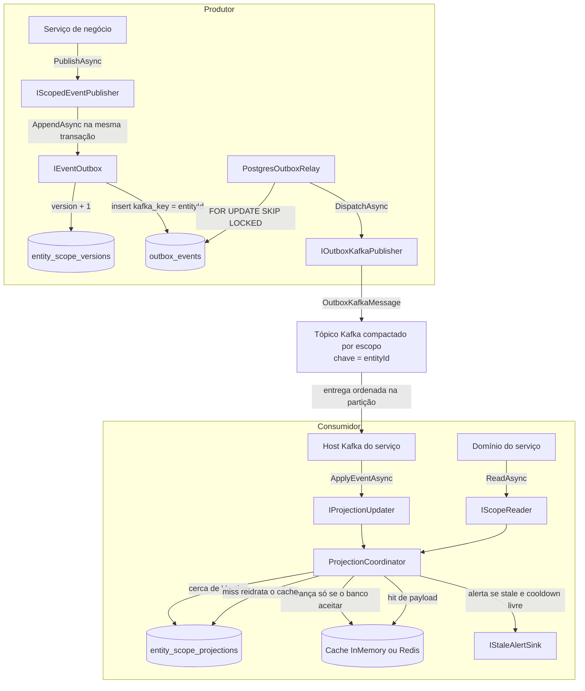

# MB.ScopedDataSync

Bibliotecas .NET 10 para sincronizar projeções de entidade entre um produtor, um tópico Kafka compactado e os consumidores de cada serviço. A `Version` é monotônica por `(entityId, scope)`. O domínio lê um snapshot com frescor. Só o consumidor de eventos grava.

## Producer e consumer

O produtor aloca a `Version` e deixa o evento na outbox. O relay publica no tópico. O host de cada serviço consumidor aplica o envelope. O domínio só lê.



`AddScopedDataSyncKafkaProducer` registra o cliente da outbox e `AddScopedDataSyncOutboxRelay` publica em loop. `AddScopedDataSyncKafka` assina o tópico. `IProjectionUpdater<T>` só resolve com a chave `ScopedDataSyncServiceKeys.EventConsumer`. O domínio recebe `IScopeReader<T>`.

Há no máximo um cache. O store PostgreSQL pode existir sozinho ou ao lado desse cache. Sem banco, a cerca de `Version` fica no cache. Com banco, o upsert condicional decide o apply e o cache só é atualizado depois. Leitura com payload no cache não consulta o banco. `IStaleAlertSink` entra na leitura quando a idade do payload passa de `StaleAfter` e o cooldown da chave `scope:entityId` permite. `IScopedDataSyncErrorHandler` é opcional e só é chamado quando a lib contém a falha. Sem registro, a lib loga e segue.

## Pacotes

| Pacote | Quando usar | Quando não usar |
| --- | --- | --- |
| `MB.ScopedDataSync.Abstractions` | Contratos compartilhados quando o projeto só depende de tipos | Instalação manual junto de `Consumer`, cache, Postgres ou `Producer`: esses pacotes já trazem `Abstractions` de forma transitiva |
| `MB.ScopedDataSync.Consumer` | Registrar `AddScopedDataSync<T>` no serviço que consome o evento | Publicar eventos ou falar com Redis, memória ou PostgreSQL sem o adaptador correspondente |
| `MB.ScopedDataSync.Caching.InMemory` | Um processo, watermark de `Version` e TTL de payload | Várias instâncias que precisam da mesma projeção quente |
| `MB.ScopedDataSync.Caching.Redis` | Cache compartilhado, isolado por serviço e escopo, com Lua atômico | Substituir o PostgreSQL como histórico durável. O TTL apaga o payload, não a watermark |
| `MB.ScopedDataSync.Storage.Postgres` | Store PostgreSQL da projeção no consumidor, sozinho ou ao lado de um cache | Alocar `Version` de negócio. Isso é responsabilidade do `Producer` |
| `MB.ScopedDataSync.Observability` | Métricas e spans de apply, descarte, falha e staleness. O host exporta o `Meter` `MB.ScopedDataSync` para Prometheus ou OTLP | Exigido para o fluxo funcionar. Sem ele, a instrumentação é no-op |
| `MB.ScopedDataSync.Producer` | Incrementar `Version` e gravar `outbox_events` na mesma transação | Aplicar projeção no serviço consumidor |
| `MB.ScopedDataSync.Messaging.Kafka` | Assinar um tópico por escopo, ou publicar a outbox com `acks=all` | Trazer o fato por arquivo, job ou outro canal. Nesse caso o serviço chama `GetRequiredEventConsumerUpdater<T>()`. Um transporte que não seja Kafka implementa `IOutboxKafkaPublisher` e não chama `AddScopedDataSyncKafkaProducer` |

Há no máximo um cache e no máximo um store de banco. `UsePostgresStore` é a implementação PostgreSQL desse store e pode acompanhar o cache escolhido ou existir sozinho. A composição não empilha InMemory, Redis e banco.

## Árvore

```text
MB.ScopedDataSync.slnx
Directory.Build.props
Directory.Packages.props
AGENTS.md
README.md
src/MB.ScopedDataSync.Abstractions
src/MB.ScopedDataSync.Consumer
src/MB.ScopedDataSync.Caching.InMemory
src/MB.ScopedDataSync.Caching.Redis
src/MB.ScopedDataSync.Storage.Postgres
src/MB.ScopedDataSync.Observability
src/MB.ScopedDataSync.Producer
src/MB.ScopedDataSync.Messaging.Kafka
tests/MB.ScopedDataSync.Tests
samples/MB.ScopedDataSync.InMemoryExample
samples/MB.ScopedDataSync.ObservabilityLocal
integration/MB.ScopedDataSync.Containers
```

`Directory.Build.props` fixa `net10.0`, nullable, warnings como erro e o pacote interno: `Company=MB`, `Authors=MB Engineering`, `PackageId` igual ao nome `MB.ScopedDataSync.*`, `VersionPrefix=1.0.0`, `GeneratePackageOnBuild=true`. Os projetos em `tests/`, `samples/` e `integration/` desligam o empacotamento.

## Desenvolvimento

O histórico segue trunk-based development. `main` é a única branch de longa duração e permanece sempre integrável.

O dia a dia sai de `main` numa branch curta:

| Prefixo | Uso |
| --- | --- |
| `feature/*` | funcionalidade |
| `bugfix/*` | correção |
| `chore/*` | manutenção |

A branch volta por pull request para `main` e entra por merge. O workflow `test` roda nesse pull request e de novo no push para `main`.

## Instalação

No feed interno:

```xml
<packageSources>
  <add key="mb-internal" value="https://nuget.internal.mb/v3/index.json" />
</packageSources>
```

```bash
dotnet add package MB.ScopedDataSync.Consumer
dotnet add package MB.ScopedDataSync.Caching.Redis
dotnet add package MB.ScopedDataSync.Storage.Postgres
dotnet add package MB.ScopedDataSync.Observability
dotnet add package MB.ScopedDataSync.Producer
dotnet add package MB.ScopedDataSync.Messaging.Kafka
```

`Abstractions` aparece como dependência transitiva. O projeto consumidor compila contra `IScopeReader<T>` sem um `PackageReference` direto.

## Publicação

A credencial fica no NuGet do usuário, em `~/.nuget/NuGet/NuGet.Config`. O `nuget.config` deste repositório só declara o nuget.org e não guarda chave.

```bash
dotnet nuget add source https://nuget.internal.mb/v3/index.json \
  --name mb-internal \
  --username mb \
  --password "$NUGET_API_KEY" \
  --store-password-in-clear-text
```

`--store-password-in-clear-text` grava a chave nesse arquivo do usuário. Sem ele, o `dotnet` no macOS e no Linux não reutiliza a senha no push.

O `Directory.Build.props` deixa `VersionPrefix` em `1.0.0`. Cada publicação informa a versão daquele envio. O feed recusa um segundo push do mesmo `PackageId` e versão.

```bash
dotnet test MB.ScopedDataSync.slnx
dotnet pack MB.ScopedDataSync.slnx -c Release -p:Version=1.0.0 -p:GeneratePackageOnBuild=false -o ./artifacts
dotnet nuget push "./artifacts/*.nupkg" \
  --source https://nuget.internal.mb/v3/index.json \
  --api-key "$NUGET_API_KEY" \
  --skip-duplicate
```

`Directory.Build.props` deixa `GeneratePackageOnBuild` ligado, então um `dotnet build` ou `dotnet test` também grava o `.nupkg`. Com essa propriedade ativa, o alvo `Pack` do SDK não chama `Build`. O `dotnet pack` da documentação desliga a propriedade só naquele comando, compila `Release` e grava os oito pacotes de `src/` em `./artifacts`. `tests/`, `samples/` e `integration/` permanecem com `IsPackable=false`. `--skip-duplicate` ignora um `.nupkg` que o feed já tem e segue com os demais.

A tag `v1.2.3` dispara `.github/workflows/release.yml`. O workflow testa, empacota com a versão da tag e publica. Antes da primeira tag, o repositório precisa da variable `NUGET_SOURCE_URL` (o `index.json` do feed) e do secret `NUGET_API_KEY`. Sem os dois, o job para na conferência e não envia pacote.

## appsettings

O `Program.cs` copia cada valor para as options. PostgreSQL usa a connection string do Npgsql. Redis usa a do StackExchange.Redis. O produtor e o consumidor Kafka entram com `MB.ScopedDataSync.Messaging.Kafka`. Sem esse pacote, o serviço aplica o envelope com o próprio job e publica a outbox com a própria implementação de `IOutboxKafkaPublisher`.

Senha, usuário e host saem do `appsettings` de cada ambiente, ou de variáveis que o host já mapeia por cima do arquivo (`ConnectionStrings__EntitySync`, `Redis__ConnectionString`, `Kafka__BootstrapServers`).

### Consumidor

```json
{
  "ConnectionStrings": {
    "EntitySync": "Host=postgres.internal;Port=5432;Database=positions;Username=positions;Password=change-me;SSL Mode=Prefer"
  },
  "Redis": {
    "ConnectionString": "redis.internal:6379,password=change-me,ssl=True,abortConnect=false",
    "ServiceName": "positions-api",
    "Database": -1,
    "PayloadTtl": "00:30:00"
  },
  "Kafka": {
    "BootstrapServers": "kafka-1.internal:9092,kafka-2.internal:9092",
    "ClientId": "positions-api",
    "GroupId": "positions-api"
  }
}
```

`ConnectionStrings:EntitySync` entra em `UsePostgresStore`. Com `EnsureSchemaOnStartup` no padrão `true`, a subida cria `entity_scope_projections` nesse banco. Passe `false` quando a migração do serviço já criou a tabela.

`Redis:ConnectionString` segue o formato do StackExchange.Redis: `host:port`, e `password`, `ssl`, `abortConnect` ou `defaultDatabase` na mesma string quando o ambiente pede. `Database` `-1` usa o banco padrão do multiplexer. Um número de `0` a `15` chama `GetDatabase` com esse índice. `ServiceName` entra na chave `mbsds:{entityId}:{service}:{scope}` e permanece o mesmo entre deploys daquele serviço. `PayloadTtl` em `hh:mm:ss` vira `PEXPIRE` só da chave `:data`. Sem a chave, o payload fica sem TTL e a hash `:meta` continua sem expirar.

`Kafka` no consumidor é lido por `AddScopedDataSyncKafka`, no pacote `MB.ScopedDataSync.Messaging.Kafka`. `GroupId` identifica o serviço e vale para todos os `FromKafkaTopic`. Cada nome é o tópico gravado na outbox daquele escopo. Sem esse pacote, o serviço aplica o envelope com o próprio job. Dois escopos são dois registros, com tipos de payload diferentes:

```csharp
builder.Services.AddScopedDataSyncKafka(kafka =>
{
    kafka.BootstrapServers = builder.Configuration["Kafka:BootstrapServers"]!;
    kafka.ClientId = builder.Configuration["Kafka:ClientId"]!;
    kafka.GroupId = builder.Configuration["Kafka:GroupId"]!;
});
builder.Services.AddScopedDataSync<IReadOnlyList<PositionSnapshot>>(sync =>
{
    sync.WithScope("positions");
    sync.FromKafkaTopic("entity.positions");
    sync.UsePostgresStore(database =>
    {
        database.ConnectionString = builder.Configuration.GetConnectionString("EntitySync");
    });
});
builder.Services.AddScopedDataSync<EntityProfile>(sync =>
{
    sync.WithScope("profile");
    sync.FromKafkaTopic("entity.profile");
    sync.UsePostgresStore(database =>
    {
        database.ConnectionString = builder.Configuration.GetConnectionString("EntitySync");
    });
});
```

### Produtor

```json
{
  "ConnectionStrings": {
    "EntityOutbox": "Host=postgres.internal;Port=5432;Database=entity;Username=outbox;Password=change-me;SSL Mode=Prefer"
  },
  "Kafka": {
    "BootstrapServers": "kafka-1.internal:9092,kafka-2.internal:9092",
    "ClientId": "positions-producer",
    "Topics": {
      "positions": "entity.positions",
      "profile": "entity.profile"
    }
  }
}
```

`ConnectionStrings:EntityOutbox` entra em `AddScopedDataSyncProducer` e aponta para o banco de `entity_scope_versions` e `outbox_events`. Pode ser o mesmo servidor de `EntitySync`. As tabelas da projeção ficam na connection string do consumidor.

`AddScopedDataSyncKafkaProducer` lê `Kafka:BootstrapServers` e `Kafka:ClientId` e produz com `Acks=All`. O mapa `Kafka:Topics` é configuração do host: a chave é o escopo e o valor é o tópico. Cada `PublishAsync` recebe o tópico daquele escopo no terceiro argumento de `PublishEntityEventRequest`, e a outbox grava esse nome na linha. O mesmo `AddScopedDataSyncProducer` e a mesma connection string servem todos os escopos. Uma publicação não se replica para vários tópicos: cada chamada incrementa a versão daquele escopo e gera uma linha de outbox. A chave da mensagem é `OutboxKafkaMessage.Key` (`entityId`) e não entra no arquivo. `cleanup.policy`, `retention.ms` e o restante da compactação configuram cada tópico no broker, na seção seguinte.

## Fluent builder

O bloco abaixo é o registro de `positions` com staleness e cache. `profile` repete a mesma forma com o próprio tipo. O tópico, quando a fonte é Kafka, entra com `FromKafkaTopic` no pacote `MB.ScopedDataSync.Messaging.Kafka`.

```csharp
using MB.ScopedDataSync.Abstractions.Alerts;
using MB.ScopedDataSync.Abstractions.Errors;
using MB.ScopedDataSync.Caching.Redis.DependencyInjection;
using MB.ScopedDataSync.Consumer.DependencyInjection;
using MB.ScopedDataSync.Observability.DependencyInjection;
using MB.ScopedDataSync.Storage.Postgres.DependencyInjection;

builder.Services.AddScopedDataSyncObservability();
builder.Services.AddSingleton<IScopedDataSyncErrorHandler, OpsSyncErrorHandler>();
builder.Services.AddSingleton<IStaleAlertSink, OpsStaleAlertSink>();
builder.Services.AddScopedDataSync<IReadOnlyList<PositionSnapshot>>(sync =>
{
    sync.WithScope("positions");
    sync.WithStaleness(options =>
    {
        options.StaleAfter = TimeSpan.FromMinutes(2);
        options.AlertCooldown = TimeSpan.FromMinutes(10);
    });
    sync.UseRedisCache(cache =>
    {
        cache.ConnectionString = builder.Configuration["Redis:ConnectionString"];
        cache.ServiceName = builder.Configuration["Redis:ServiceName"]!;
        cache.Database = builder.Configuration.GetValue("Redis:Database", -1);
        var payloadTtl = builder.Configuration["Redis:PayloadTtl"];
        if (!string.IsNullOrWhiteSpace(payloadTtl))
        {
            cache.PayloadTtl = TimeSpan.Parse(payloadTtl);
        }
    });
    sync.UsePostgresStore(database =>
    {
        database.ConnectionString = builder.Configuration.GetConnectionString("EntitySync");
    });
});
```

Para um único processo, troque `UseRedisCache` por `UseInMemoryCache`. Os dois métodos no mesmo builder lançam na composição. `UsePostgresStore` sozinho também é válido.

`AddScopedDataSyncObservability` publica o `Meter` e o `ActivitySource` `MB.ScopedDataSync`. Prometheus, Grafana e um coletor OTLP ficam no host: o pacote não referencia exporter. O README de `MB.ScopedDataSync.Observability` tem o registro, um exemplo de apply, descarte, leitura e falha, o dashboard Grafana e as regras Prometheus.

## Leitura no domínio

```csharp
public sealed class PortfolioService(IScopeReader<IReadOnlyList<PositionSnapshot>> reader)
{
    public async Task<IReadOnlyList<PositionSnapshot>> GetAsync(string entityId, CancellationToken cancellationToken)
    {
        var result = await reader.ReadAsync(entityId, cancellationToken);
        return result.Freshness.Status switch
        {
            DataFreshnessStatus.Fresh or DataFreshnessStatus.SyncImpaired => result.Data ?? [],
            DataFreshnessStatus.Stale => result.Data ?? [],
            _ => []
        };
    }
}
```

O reader devolve o último payload junto com `FreshnessInfo`. `Stale` ainda contém o dado e pode ter emitido `StaleRecordAlert` se o cooldown da chave `positions:{entityId}` permitiu. `SyncImpaired` significa falha de sync com payload dentro da janela, sem alerta de staleness.

## Atualização no consumidor de eventos

O updater não está no container sem chave. O host do consumidor resolve assim:

```csharp
var updater = provider.GetRequiredEventConsumerUpdater<IReadOnlyList<PositionSnapshot>>();
var outcome = await updater.ApplyEventAsync(
    new ScopedEventEnvelope<IReadOnlyList<PositionSnapshot>>(
        entityId,
        "positions",
        version,
        positions,
        occurredAtUtc),
    cancellationToken);

await updater.RecordSyncFailureAsync(
    new SyncFailure(entityId, "Falha ao desserializar o lote.", DateTimeOffset.UtcNow),
    cancellationToken);
```

`incoming.Version > current.Version` grava. Versão igual ou menor devolve `DiscardedStaleOrDuplicate` e não mexe no cache quando o store de banco recusou. `RecordSyncFailureAsync` não reduz `Version`.

Um serviço de domínio que peça `IProjectionUpdater<T>` no construtor não resolve: o registro é keyed e a interface leva `EventConsumerOnly`.

## Falha contida

`IScopedDataSyncErrorHandler` registra antes de `AddScopedDataSync`. Sem a linha, a lib loga e segue. O handler não devolve decisão: não confirma offset, não troca o resultado da leitura e não impede o retry. Se ele lançar, a exceção é logada e o comportamento padrão permanece.

Falha do store principal em `ReadAsync`, `ApplyEventAsync`, `RecordSyncFailureAsync` e `PublishAsync` continua subindo para o serviço. O handler não é chamado. O loop do relay contém a falha de `DispatchAsync` e avisa `OutboxRelayFaulted`. Uma chamada direta de `DispatchAsync` continua lançando.

```csharp
builder.Services.AddSingleton<IScopedDataSyncErrorHandler, OpsSyncErrorHandler>();
builder.Services.AddSingleton<IStaleAlertSink, OpsStaleAlertSink>();

builder.Services.AddScopedDataSyncKafka(kafka =>
{
    kafka.BootstrapServers = builder.Configuration["Kafka:BootstrapServers"]!;
    kafka.ClientId = builder.Configuration["Kafka:ClientId"]!;
    kafka.GroupId = builder.Configuration["Kafka:GroupId"]!;
});

builder.Services.AddScopedDataSync<PositionSnapshot>(sync =>
{
    sync.WithScope("positions");
    sync.FromKafkaTopic("entity.positions");
    sync.UseRedisCache(BindRedis);
    sync.UsePostgresStore(store =>
        store.ConnectionString = builder.Configuration.GetConnectionString("EntitySync")!);
});

public sealed class OpsSyncErrorHandler(ILogger<OpsSyncErrorHandler> logger) : IScopedDataSyncErrorHandler
{
    public Task HandleAsync(ScopedDataSyncFailure failure, CancellationToken cancellationToken = default)
    {
        switch (failure.Kind)
        {
            case ScopedDataSyncFailureKind.CacheDegraded:
                logger.LogWarning(
                    failure.Exception,
                    "Leitura de {Scope} da entidade {EntityId} caiu para o banco.",
                    failure.Scope,
                    failure.EntityId);
                break;

            case ScopedDataSyncFailureKind.StaleAlertFailed:
                logger.LogWarning(
                    failure.Exception,
                    "Alerta de {Scope} da entidade {EntityId} não foi publicado.",
                    failure.Scope,
                    failure.EntityId);
                break;

            case ScopedDataSyncFailureKind.KafkaMessageRetrying:
                logger.LogError(
                    failure.Exception,
                    "Evento de {Scope} da entidade {EntityId} permanece na partição.",
                    failure.Scope,
                    failure.EntityId);
                break;

            case ScopedDataSyncFailureKind.KafkaConsumerFaulted:
                logger.LogError(
                    failure.Exception,
                    "Consumidor Kafka falhou em {Operation} e o loop continua.",
                    failure.Operation);
                break;

            case ScopedDataSyncFailureKind.OutboxRelayFaulted:
                logger.LogError(
                    failure.Exception,
                    "Relay da outbox falhou e o lote continua sem published_at_utc.");
                break;
        }

        return Task.CompletedTask;
    }
}
```

Com Redis e Postgres, uma queda do cache chega como `CacheDegraded` e a leitura devolve o banco. Sem banco, ou com o Postgres indisponível, `ReadAsync` lança. O job que chama `ApplyEventAsync` direto trata essa exceção no próprio `catch`. Pelo hosted service do Kafka, a falha de gravar vira `KafkaMessageRetrying`: o offset fica aberto, a partição daquela mensagem espera 1 segundo e os outros tópicos continuam. `KafkaConsumerFaulted` é falha de `Consume` ou `Commit`. O processo permanece no ar. No produtor, falha do relay chega como `OutboxRelayFaulted`: o lote não é marcado como publicado e o loop tenta de novo.

```csharp
public sealed class PortfolioService(IScopeReader<PositionSnapshot> reader)
{
    public async Task<PositionSnapshot?> GetAsync(string entityId, CancellationToken cancellationToken)
    {
        var result = await reader.ReadAsync(entityId, cancellationToken);
        return result.Data;
    }
}

try
{
    await updater.ApplyEventAsync(envelope, cancellationToken);
}
catch (Exception exception) when (exception is not OperationCanceledException)
{
    logger.LogError(exception, "Apply de {EntityId} falhou.", envelope.EntityId);
    throw;
}
```

## Staleness e cooldown

`StaleAfter` é a idade máxima do `OccurredAtUtc` aplicado. Na primeira leitura stale, `IStaleAlertSink` recebe o alerta e a chave entra em cooldown. Leituras seguintes dentro de `AlertCooldown` mantêm `AlertSuppressedByCooldown`. Falha do sink desfaz o cooldown para a próxima leitura tentar de novo, e a leitura da entidade continua.

## Store PostgreSQL e upsert externo

O pacote cria `entity_scope_projections` com chave `(entity_id, scope)`. O apply é um único statement:

```sql
ON CONFLICT (entity_id, scope)
DO UPDATE SET version = EXCLUDED.version, payload = EXCLUDED.payload, ...
WHERE entity_scope_projections.version < EXCLUDED.version
```

A escrita direta na tabela, fora de `IProjectionUpdater<T>`, fura a cerca se não repetir esse `WHERE`. O adaptador não expõe um upsert incondicional. Falha de sync atualiza só `consecutive_failures`, `last_failure_at_utc` e `last_failure_reason`.

## Produtor e outbox

```csharp
builder.Services.AddScopedDataSyncProducer(options =>
{
    options.ConnectionString = builder.Configuration.GetConnectionString("EntityOutbox");
});
builder.Services.AddScopedDataSyncKafkaProducer(kafka =>
{
    kafka.BootstrapServers = builder.Configuration["Kafka:BootstrapServers"]!;
    kafka.ClientId = builder.Configuration["Kafka:ClientId"]!;
});
builder.Services.AddScopedDataSyncOutboxRelay(relay =>
{
    relay.BatchSize = 100;
    relay.IdleDelay = TimeSpan.FromSeconds(1);
});

var publisher = provider.GetRequiredService<IScopedEventPublisher>();
var positions = await publisher.PublishAsync(
    new PublishEntityEventRequest<IReadOnlyList<PositionSnapshot>>(
        entityId,
        "positions",
        builder.Configuration["Kafka:Topics:positions"]!,
        remainingPositions));
var profile = await publisher.PublishAsync(
    new PublishEntityEventRequest<EntityProfile>(
        entityId,
        "profile",
        builder.Configuration["Kafka:Topics:profile"]!,
        entityProfile));
```

A transação incrementa `entity_scope_versions` (`version = version + 1`) e insere `outbox_events` com `kafka_key = entityId`. Lista vazia ou nula vira `[]` no JSON. `PublishAsync` não fala com o broker. O hosted service de `AddScopedDataSyncOutboxRelay` chama `PostgresOutboxRelay.DispatchAsync`: reserva linhas com `FOR UPDATE SKIP LOCKED`, publica e marca `published_at_utc` antes do commit. Lote vazio espera `IdleDelay`. Falha de envio desfaz a reserva, avisa `OutboxRelayFaulted` e o processo continua. `DispatchAsync` chamado direto ainda lança.

`OutboxKafkaMessage.Key` é o `entityId`. O valor carrega `entityId`, `scope`, `version`, `occurredAtUtc` e `payload`.

## Tópico Kafka por escopo

Um tópico por escopo, por exemplo `entity.positions` e `entity.profile`. A chave da mensagem é `entityId`, então todas as versões daquela entidade caem na mesma partição e a ordem local se mantém. A cerca de `Version` no consumidor ainda descarta reentrega.

```properties
cleanup.policy=compact
retention.ms=-1
min.cleanable.dirty.ratio=0.1
segment.ms=300000
delete.retention.ms=86400000
min.insync.replicas=2
```

`cleanup.policy=compact` guarda a última mensagem de cada chave e remove versões antigas. `retention.ms=-1` evita expiração por tempo. `min.cleanable.dirty.ratio=0.1` torna a compactação elegível mais cedo. `segment.ms=300000` fecha o segmento para a compactação não esperar o padrão de sete dias. `delete.retention.ms` só importa para tombstones. Este produtor não envia valor `null`: item removido de uma lista publica `[]`, e a chave da entidade permanece. Um tombstone apagaria a projeção inteira na compactação.

O cliente de `AddScopedDataSyncKafkaProducer` usa `acks=all` e a chave `OutboxKafkaMessage.Key`. O callback `Configure` ajusta SASL ou SSL, e `Acks` volta para `All` depois dele. Não converta `payload: []` em `null`.

## Testes

```bash
dotnet test MB.ScopedDataSync.slnx
```

Os testes unitários em `tests/` cobrem ordenação e concorrência em memória, a recusa de dois caches, o cooldown, a ausência do updater no domínio e a alocação de versão com outbox. O SQL condicional e os scripts Lua continuam afirmados como contrato.

`samples/MB.ScopedDataSync.InMemoryExample` é o host de exemplo: publica com `IEventOutbox` em memória, entrega `OutboxKafkaMessage` e o domínio lê por `IScopeReader<T>` com `UseInMemoryCache`. `integration/MB.ScopedDataSync.Containers` sobe PostgreSQL e Redis com Testcontainers quando `docker info` responde. Sem Docker esses testes são ignorados. No GitHub Actions, o job `ubuntu-latest` executa a solution inteira e o daemon do runner atende o Testcontainers.
